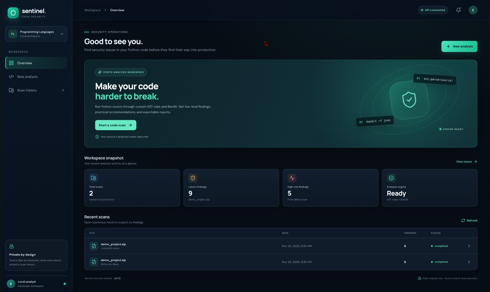
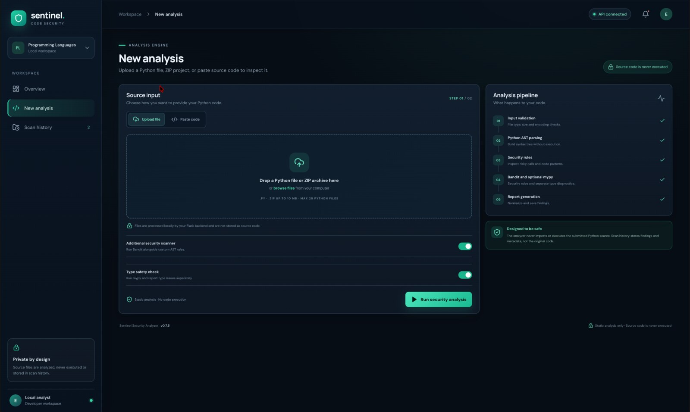
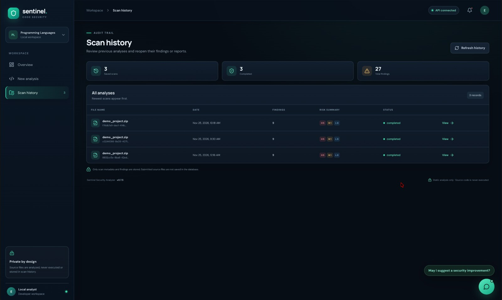
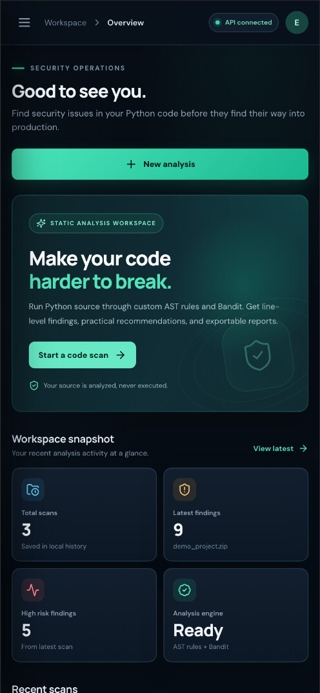
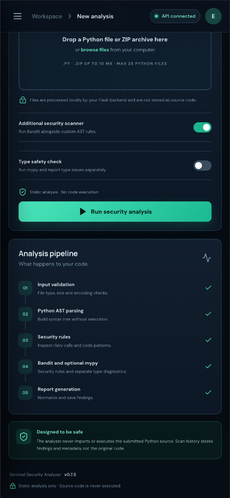
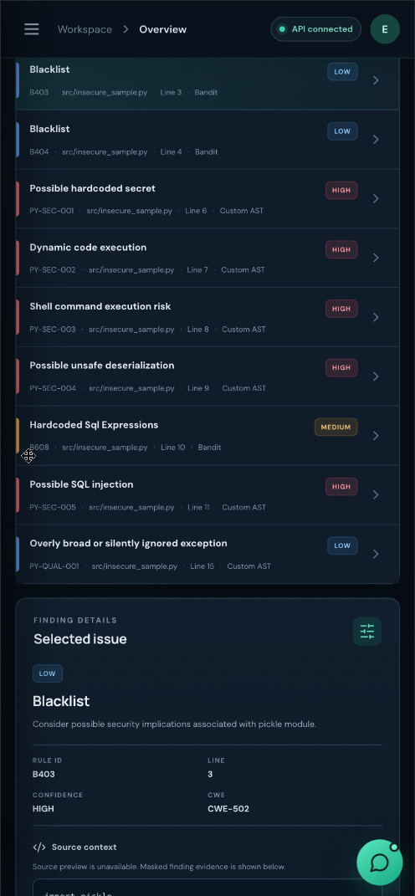
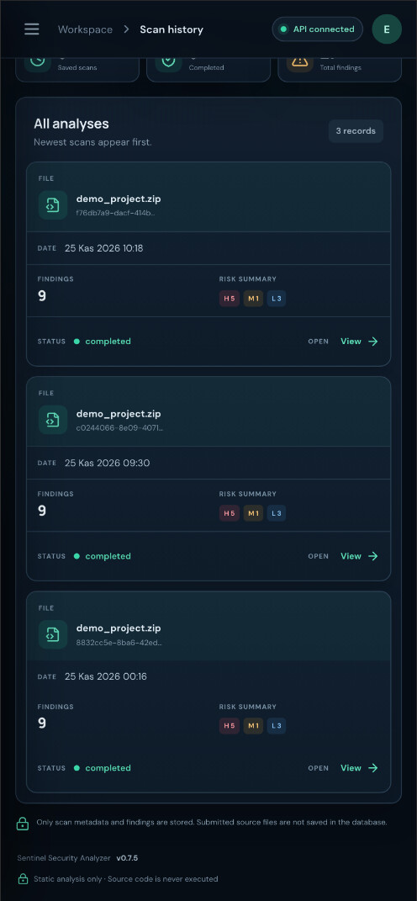
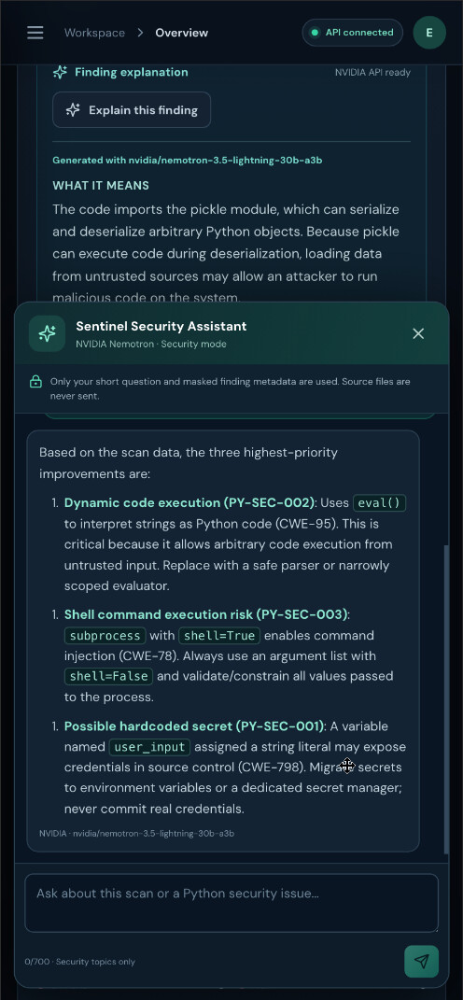
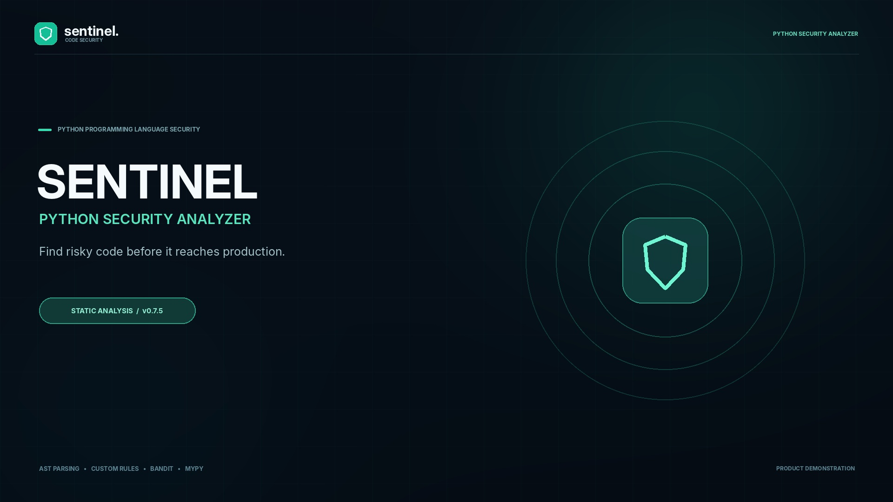
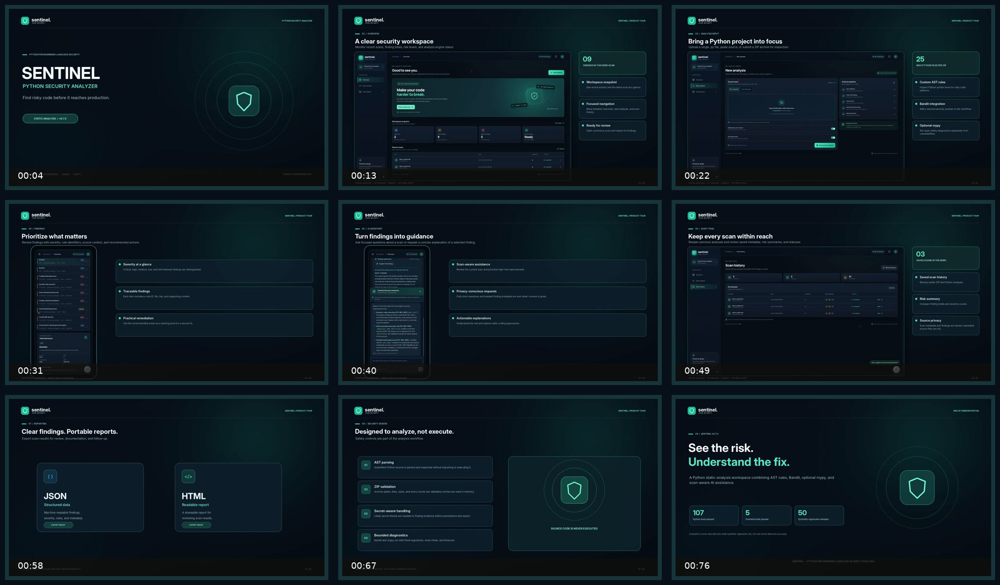

# Sentinel — Python Programming Language Security Analyzer

**Sentinel Security Analyzer v0.7.5** is an academic software project for the Programming Languages course (Topic No. 13). It performs static security analysis of Python source code using Python's Abstract Syntax Tree (AST), a focused set of custom security rules, and Bandit. It can optionally run mypy as a separate type-safety check.

The application accepts individual Python files, pasted source code, and ZIP archives containing Python projects. A Flask API powers a React + Vite dashboard, while SQLite stores scan metadata and findings.

> **Safety principle:** Submitted Python source is parsed and analyzed. Sentinel does not import or execute submitted source files. ZIP entries are inspected in memory and are not extracted to the filesystem.

---

## Contents

- [Project overview](#project-overview)
- [Features](#features)
- [Technology stack](#technology-stack)
- [Architecture](#architecture)
- [Security rules](#security-rules)
- [Security and privacy design](#security-and-privacy-design)
- [Requirements](#requirements)
- [Installation and setup](#installation-and-setup)
- [Running Sentinel](#running-sentinel)
- [Using the command-line interface](#using-the-command-line-interface)
- [API reference](#api-reference)
- [ZIP upload limits](#zip-upload-limits)
- [AI-assisted explanations and Security Assistant](#ai-assisted-explanations-and-security-assistant)
- [Evaluation](#evaluation)
- [Database](#database)
- [Tests](#tests)
- [Known limitations](#known-limitations)
- [Screenshots and demo](#screenshots-and-demo)

## Project overview

Sentinel is designed to demonstrate how language-processing techniques can support secure software development. It parses Python source code, inspects syntax-tree patterns, applies custom rules, and combines those results with Bandit findings. The dashboard lets a user inspect findings, review source context, filter by severity, reopen previous scans, and export reports.

The optional mypy integration is deliberately presented separately from security findings. Type-checking diagnostics can help identify type-safety problems, but a type error is not automatically a security vulnerability.

Sentinel is an assistive static-analysis tool. Its findings are heuristic indicators that require human review; they are not proof that a program is exploitable or secure.

## Features

### Analysis

- Analyze an individual `.py` file or pasted Python source.
- Upload ZIP archives containing Python projects.
- Parse Python source with `ast` without importing or executing it.
- Apply custom AST-based security rules.
- Run Bandit as an additional security scanner.
- Normalize selected duplicate AST/Bandit detections while retaining related scanner rule IDs.
- Optionally run mypy as a separate type-safety check.
- Display severity counts, finding details, source context, recommendations, and related detections.

### Dashboard and reporting

- React + Vite dashboard served through a Flask application.
- Dark security-operations interface with responsive desktop and mobile layouts.
- Dashboard overview, new analysis workflow, results view, and scan history.
- Search and severity filtering for findings.
- Scan history backed by SQLite.
- JSON and HTML report exports.
- Mobile-friendly scan-history cards and a responsive Security Assistant panel.

### AI assistance

- Finding explanations with deterministic local guidance when no NVIDIA API key is configured.
- Optional NVIDIA Nemotron explanations after explicit per-request consent.
- Scan-aware Security Assistant for focused questions about the current scan and Python security.
- Server-side API-key handling and masking of selected finding metadata before external processing.
- Assistant chat history remains in browser memory and is not stored in SQLite.

## Technology stack

| Area | Technology |
|---|---|
| Language analysis | Python `ast` |
| Custom detection | Python AST-based rules |
| Additional security scanner | Bandit |
| Optional type checking | mypy |
| Backend and API | Flask |
| Local persistence | SQLite |
| Frontend | React, Vite, JavaScript |
| Icons | Lucide React |
| Automated tests | pytest and Node.js built-in test runner |
| Optional hosted AI | NVIDIA Chat Completions API |

## Architecture

At a high level, a scan follows this path:

1. The user submits a Python file, pasted source, or ZIP archive through the dashboard or API.
2. The Flask layer validates the request and applies file/archive limits.
3. Python source is parsed and inspected by the custom AST analyzer.
4. Bandit can run as an additional scanner; selected duplicate detections are normalized.
5. mypy can run separately when requested.
6. Scan metadata, findings, and type-check diagnostics are stored in SQLite.
7. The dashboard displays the result and provides JSON/HTML report links.

Architecture and analysis-flow diagrams are available in `docs/`:

- `docs/ARCHITECTURE.md`
- `docs/ANALYSIS_FLOWCHART.md`
- `docs/diagrams/architecture.svg`
- `docs/diagrams/analysis-flowchart.svg`

## Security rules

The current custom rule set includes:

| Rule ID | Description | Default severity |
|---|---|---|
| `PY-SEC-001` | Possible hardcoded secret | HIGH |
| `PY-SEC-002` | Dynamic execution through `eval()` or `exec()` | HIGH |
| `PY-SEC-003` | `os.system()` or subprocess execution with `shell=True` | HIGH |
| `PY-SEC-004` | Unsafe deserialization through `pickle.load()` or `pickle.loads()` | HIGH |
| `PY-SEC-005` | Dynamic SQL passed to `execute()` | HIGH |
| `PY-QUAL-001` | Broad or silently ignored exception | LOW |

Bandit findings retain their original test IDs and are marked with `source: "bandit"`.

When a custom AST rule and Bandit report the same file and line with a matching CWE or a known equivalent rule pair, the custom finding remains the primary item and the Bandit rule is attached in `related_findings`. Known equivalents include Bandit B307 with `PY-SEC-002` and B110 with `PY-QUAL-001`. This is a heuristic normalization step, not proof that two findings are semantically identical.

## Security and privacy design

- Submitted Python source is parsed; it is not imported or executed.
- ZIP archive entries are read in memory and are not extracted to disk.
- ZIP paths are validated; absolute paths, traversal paths, symbolic links, encrypted entries, duplicate paths, invalid UTF-8, and corrupted archives are rejected.
- File size, archive size, entry count, Python-file count, and expanded-size limits are enforced.
- Bandit and mypy are invoked with fixed argument lists and `shell=False`, with timeouts.
- Temporary files/directories used by integrations are removed after use.
- SQLite queries use bound parameters.
- User-controlled filenames are sanitized.
- Likely secret literals are masked in finding evidence before persistence and export.
- Source-derived frontend values are rendered as text; raw HTML is not injected.
- HTML report values are escaped before rendering.
- Type-check diagnostics are kept separate from security findings.
- The NVIDIA API key remains on the server. External requests require explicit user consent.

Secret masking is a best-effort safeguard, not a guarantee that every possible credential format will be detected. Do not upload secrets or commit API keys.

## Requirements

- Python 3.10 or newer.
- Node.js 18 or newer; Node.js 20 LTS or 22 LTS is recommended.
- npm.
- Dependencies listed in `requirements.txt` and `frontend/package.json`.

The project has been exercised locally on macOS. Optional integrations such as NVIDIA explanations require their corresponding configuration and provider availability.

## Installation and setup

Run these commands from the project root.

### 1. Create and activate the Python environment

```bash
python3 -m venv .venv
source .venv/bin/activate
python -m pip install --upgrade pip
python -m pip install -r requirements.txt
```

### 2. Configure optional NVIDIA access

Copy `.env.example` to `.env` only if you want to configure the optional hosted NVIDIA feature:

```bash
cp .env.example .env
```

Add your own `NVIDIA_API_KEY` to the local `.env` file. Keep `.env` out of version control. Without a key, Sentinel uses local guidance and does not make an external AI request.

The application pins its NVIDIA model ID in the backend rather than accepting a user-provided model override.

### 3. Install frontend dependencies

```bash
cd frontend
npm install
cd ..
```

## Running Sentinel

### Development mode

Use two Terminal tabs.

**Terminal 1 — backend:**

```bash
source .venv/bin/activate
python -m security_analyzer.web
```

**Terminal 2 — frontend:**

```bash
cd frontend
npm run dev
```

Open the Vite development URL:

```text
http://127.0.0.1:5173
```

Vite proxies `/api` requests to the Flask backend on port `5000`. Keep both processes running while using the development server.

### Production-style local build

From the project root:

```bash
cd frontend
npm run build
cd ..
source .venv/bin/activate
python -m security_analyzer.web
```

When `frontend/dist` exists, Flask serves the built dashboard at:

```text
http://127.0.0.1:5000/
```

The backend binds to localhost by default. Do not expose this development configuration directly to the public internet.

## Using the command-line interface

Scan a Python file with the default AST and Bandit checks:

```bash
python -m security_analyzer sample_code/insecure_sample.py
```

Run mypy as an additional, separate type-safety check:

```bash
python -m security_analyzer sample_code/insecure_sample.py --mypy
```

Skip Bandit:

```bash
python -m security_analyzer sample_code/insecure_sample.py --no-bandit
```

## API reference

| Method | Endpoint | Purpose |
|---|---|---|
| `GET` | `/` | Dashboard after frontend build, or backend status JSON in the applicable test/API mode |
| `GET` | `/api/health` | Backend health and optional feature availability |
| `POST` | `/api/scan` | Analyze a `.py` file, `.zip` archive, or JSON source text |
| `GET` | `/api/scans` | List previous scan summaries (`limit` 1–100) |
| `GET` | `/api/scans/<scan_id>` | Read one scan and its findings |
| `GET` | `/api/scans/<scan_id>/report.json` | Download a JSON report |
| `GET` | `/api/scans/<scan_id>/report.html` | Download an HTML report |
| `POST` | `/api/assistant/chat` | Send a bounded, scan-aware Security Assistant message |
| `POST` | `/api/scans/<scan_id>/findings/<finding_id>/explain` | Request an explanation for a finding |

### Upload a Python file

```bash
curl -X POST http://127.0.0.1:5000/api/scan \
  -F "file=@sample_code/insecure_sample.py" \
  -F "include_bandit=true" \
  -F "include_mypy=false"
```

### Upload the included ZIP demo project

```bash
curl -X POST http://127.0.0.1:5000/api/scan \
  -F "file=@sample_code/demo_project.zip" \
  -F "include_bandit=true" \
  -F "include_mypy=true"
```

### Submit pasted source as JSON

```bash
curl -X POST http://127.0.0.1:5000/api/scan \
  -H "Content-Type: application/json" \
  -d '{"filename":"pasted_code.py","source":"eval(user_input)\n","include_bandit":true,"include_mypy":false}'
```

`include_mypy` defaults to `false`. If mypy is unavailable or times out, the security scan can still complete; the type-check status explains the issue separately.

## ZIP upload limits

- Maximum compressed archive upload: 10 MB.
- Maximum archive entries: 100.
- Maximum Python files: 25.
- Maximum size per Python file: 1 MB.
- Maximum total uncompressed archive size: 5 MB.
- Only `.py` entries are analyzed; other ordinary files are skipped with a warning.
- Absolute paths, `..` traversal paths, symbolic links, encrypted entries, duplicate paths, invalid UTF-8, and corrupted archives are rejected.
- ZIP entries are read in memory; the server does not extract archive entries to the filesystem.
- Finding paths retain archive-relative names, such as `src/module.py`.

## AI-assisted explanations and Security Assistant

### Finding explanations

Without an API key, the application uses built-in rule guidance and makes no external request. To enable hosted NVIDIA explanations, set `NVIDIA_API_KEY` in the backend environment before starting Flask.

When NVIDIA mode is enabled, the UI asks for explicit consent before each request. Only selected finding metadata and redacted evidence are sent to the NVIDIA Chat Completions endpoint. The original source file is not sent. The API key is kept server-side.

The model ID is pinned to `nvidia/nemotron-3.5-lightning-30b-a3b`. Provider quotas, rate limits, endpoint availability, and account terms may affect requests.

### Security Assistant

The floating Security Assistant is available when a scan is open. It can summarize the current scan, explain selected findings, and answer focused questions about Python security and remediation.

The chat endpoint is intentionally constrained:

- Maximum message length: 700 characters.
- Recent conversation context: up to 6 entries.
- Maximum request body: 8 KB.
- In-memory rate limit: 8 requests per client IP per 10 minutes.
- NVIDIA chat response budget: up to 900 tokens.
- Chat history is kept in browser memory and is not persisted to SQLite.
- Explicit per-request consent is required before an NVIDIA chat request.
- Chat sends the user question and a compact, masked finding summary; it excludes original source files, source evidence, file paths, environment variables, and API keys.
- Scope and safety checks reject unrelated or oversized prompts, prompt-injection patterns, malware-building requests, pasted source code, and likely credentials before a provider call.
- Assistant responses are checked for leaked credentials and unsafe calls in fenced Python examples before display.
- Assistant Markdown is rendered as safe React text nodes; raw HTML is not interpreted.

AI output is advisory. Verify explanations and review code changes manually. Security severity is determined by the scanners, not by the AI model.

## Evaluation

Run the labeled synthetic regression dataset:

```bash
python -m security_analyzer.evaluation
```

The evaluation command reports TP, FP, FN, TN, Precision, Recall, F1-score, Specificity, and Accuracy overall and per custom rule.

The current regression dataset contains **50 hand-labeled synthetic examples** across five custom security rules: 10 examples per rule, with five positive and five negative examples per rule. The latest local evaluation reported:

| Metric | Result |
|---|---:|
| True Positive | 25 |
| False Positive | 0 |
| False Negative | 0 |
| True Negative | 25 |
| Precision | 1.00 |
| Recall | 1.00 |
| F1-score | 1.00 |
| Specificity | 1.00 |
| Accuracy | 1.00 |
| Sample count | 50 |

> **Evaluation caveat:** These metrics describe only this small, hand-labeled synthetic regression set. They are not a measure of real-world detection accuracy. A larger, independently labeled dataset and broader external validation are required for meaningful empirical claims.

## Database

By default, scan history is stored in:

```text
security_analyzer/instance/scans.sqlite3
```

Set `SECURITY_ANALYZER_DB` to use another local path. The database stores scan metadata, findings, type-check diagnostics, and archive-relative file names. It does not store complete submitted source files.

Local database files are excluded from version control.

## Tests

Run the backend test suite from the project root:

```bash
python -m pytest -q
```

Run frontend parser tests:

```bash
cd frontend
npm test
```

Create a production frontend build:

```bash
npm run build
```

The latest local verification recorded during project preparation was:

- Python: **107 passed**.
- Frontend: **5 passed**.
- Vite production build: **successful**.
- Synthetic evaluation: **50 samples**.

These are local verification results from the development environment; they are not a hosted CI result.

## Known limitations

- The custom rule engine is intentionally small and does not perform full interprocedural or data-flow analysis.
- It does not understand every import alias or prove whether a value is attacker-controlled.
- It does not cover every possible SQL construction style or all Python vulnerability classes.
- Bandit may report patterns that require manual review and may produce false positives.
- mypy checks type consistency; it does not prove that code is secure.
- Secret masking is best-effort and cannot guarantee detection of every credential format.
- Static-analysis findings are heuristic indicators, not proof of exploitability.
- False positives and false negatives are expected; broader independent evaluation is still needed.
- The local Flask configuration is intended for development and local demonstration. Authentication, CSRF protections, and a shared production-grade rate limiter are required before exposing the application beyond localhost.

## Screenshots

### Desktop

**Dashboard**



**New analysis**



**Scan history**



### Responsive mobile views

The following captures use an iPhone 14 Pro Max browser-emulation viewport configured at 430 × 932 CSS pixels. They demonstrate responsive layout and are not a physical-device certification.

| Dashboard | New analysis |
|---|---|
|  |  |

| Analysis results | Scan history |
|---|---|
|  |  |

**Security Assistant**



### Demo video

[](https://github.com/ErenA001/sentinel-python-security-analyzer/releases/latest/download/Sentinel_Product_Demo.mp4)

[Watch or download the Sentinel demo video (MP4)](https://github.com/ErenA001/sentinel-python-security-analyzer/releases/latest/download/Sentinel_Product_Demo.mp4)

### Demo contact sheet



[Open the full demo contact sheet](docs/demo/contact-sheet.jpg)
---

## Project status

The local application has been implemented and manually exercised on macOS. The backend and frontend test suites pass in the current development environment, and the responsive dark dashboard is in place.

Academic report, presentation slides, final screenshots, and the demo video are separate project deliverables and are being prepared after the software and repository presentation are finalized.
