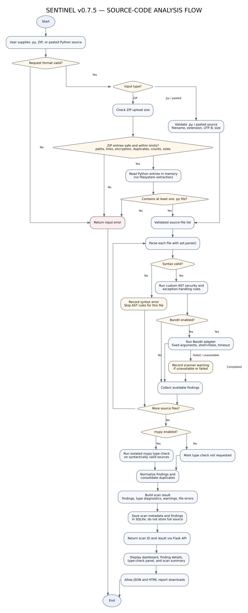
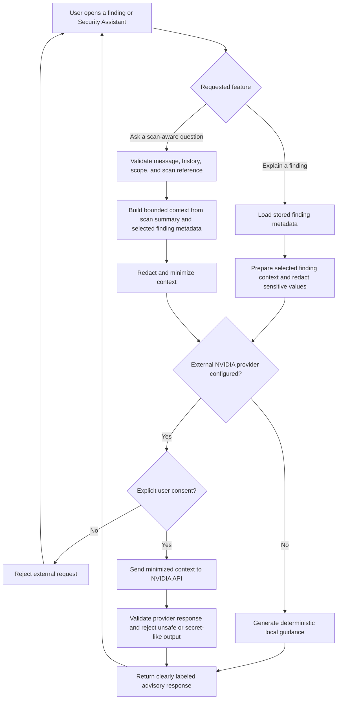

# Sentinel Programming Language Security Analyzer

## Source-Code Analysis Flowchart — Version 0.7.5

This flowchart describes the implemented scan workflow, including single-file input, ZIP validation, optional scanners, result storage, and optional AI assistance.



## 1. Main scan workflow

```mermaid
flowchart TD
    START([Start]) --> INPUT[User selects a Python file, ZIP archive, or pastes source code]
    INPUT --> REQUEST{Is the request format valid?}
    REQUEST -->|No| REJECT[Return a clear input error]
    REQUEST -->|Yes| KIND{Input type}

    KIND -->|Pasted source / .py| SINGLE[Validate filename, extension, UTF-8, and file-size limit]
    KIND -->|.zip| ZIPSIZE[Validate ZIP upload-size limit]
    ZIPSIZE --> ZIPOPEN[Open archive in memory]
    ZIPOPEN --> ZIPSAFE{Archive entries safe and within limits?}
    ZIPSAFE -->|No| REJECT
    ZIPSAFE -->|Yes| ZIPFILES[Read valid .py entries without extracting paths]
    ZIPFILES --> HASPY{At least one Python file?}
    HASPY -->|No| REJECT
    HASPY -->|Yes| SOURCES[Create list of validated source files]
    SINGLE --> SOURCES

    SOURCES --> LOOP[Process each Python source file]
    LOOP --> PARSE[Parse source with ast.parse()]
    PARSE --> VALID{Syntax valid?}
    VALID -->|No| SYNTAX[Record file-level syntax error]
    VALID -->|Yes| AST[Walk AST with custom security rules]
    AST --> RULES[Detect selected security and exception-handling patterns]
    RULES --> BANDITQ{Bandit enabled?}
    BANDITQ -->|Yes| BANDIT[Run Bandit with fixed arguments, shell=False, and timeout]
    BANDITQ -->|No| JOIN[Collect available findings]
    BANDIT --> BANDITOK{Bandit completed?}
    BANDITOK -->|No| WARNING[Record scanner warning]
    BANDITOK -->|Yes| BANDITFINDINGS[Normalize Bandit output]
    WARNING --> JOIN
    BANDITFINDINGS --> JOIN
    JOIN --> NEXT{More source files?}
    SYNTAX --> NEXT
    NEXT -->|Yes| LOOP
    NEXT -->|No| MYPYQ{mypy enabled?}

    MYPYQ -->|Yes| MYPY[Type-check syntactically valid sources in an isolated temporary directory]
    MYPYQ -->|No| NOTYPE[Mark type check as not requested]
    MYPY --> TYPERESULT[Keep type diagnostics separate from security findings]
    NOTYPE --> NORMALIZE[Normalize findings and consolidate duplicates]
    TYPERESULT --> NORMALIZE
    NORMALIZE --> SUMMARY[Build scan summary, counts, warnings, and file errors]
    SUMMARY --> STORE[Persist scan metadata and findings in SQLite]
    STORE --> RESPONSE[Return scan ID and result through Flask API]
    RESPONSE --> DASHBOARD[Display findings, type-check panel, and scan summary]
    DASHBOARD --> EXPORT[Allow JSON / HTML report download]
    EXPORT --> END([End])

    REJECT --> END
```

## 2. Optional AI explanation and assistant flow

AI support is separate from the core detection pipeline. A scan can complete without an AI provider or API key.



## 3. Input-safety checks

The ZIP intake path applies the following checks before source files enter the analysis pipeline:

- Maximum ZIP upload size: 10,000,000 bytes
- Maximum archive entries: 100
- Maximum Python files: 25
- Maximum individual Python file size: 1,000,000 bytes
- Maximum total uncompressed archive size: 5,000,000 bytes
- Reject absolute paths, `..` path components, invalid names, symbolic links, encrypted entries, and duplicate paths
- Read entries in memory; do not extract archive paths to disk
- Decode Python source as UTF-8 (with UTF-8 BOM support)

## 4. Result interpretation

- **Security findings:** Produced by custom AST rules and, when enabled, Bandit.
- **Type-check diagnostics:** Produced by optional mypy analysis and displayed separately.
- **Syntax errors:** Recorded per file; AST security rules cannot inspect a file that fails parsing.
- **Scanner warnings:** Explain when an optional scanner is unavailable or cannot complete.
- **AI responses:** Advisory explanations only; they do not change findings, severity, or scan results.

The expanded evaluation utility uses 50 hand-labeled synthetic regression samples (10 per custom security rule: five vulnerable and five safe). Its metrics are useful for regression checks only and are not evidence of production detection accuracy.
