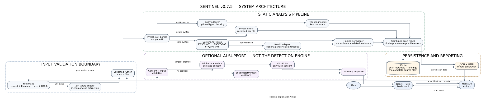

# Sentinel Programming Language Security Analyzer

## System Architecture — Version 0.7.5

This document describes the implemented architecture of Sentinel v0.7.5. It distinguishes the core static-analysis path from optional type-checking and AI-assisted explanation features.

## 1. Architecture overview

```mermaid
flowchart LR
    U[User] --> UI[React + Vite Dashboard]
    UI --> API[Flask API]

    subgraph INPUT[Input and validation boundary]
        API --> INTAKE[File intake and request validation]
        INTAKE --> PY[Python source input]
        INTAKE --> ZIP[ZIP archive input]
        ZIP --> ZIPCHECK[In-memory ZIP safety checks]
        ZIPCHECK --> PYFILES[Validated Python files]
        PY --> PYFILES
    end

    subgraph ANALYSIS[Static-analysis pipeline]
        PYFILES --> PARSER[Python AST parser]
        PARSER -->|Valid syntax| RULES[Custom AST security rules]
        PARSER -->|Syntax error| PARSEERR[Record syntax error]
        RULES --> BANDIT{Bandit enabled?}
        BANDIT -->|Yes| BANDITRUN[Bandit adapter]
        BANDIT -->|No| NORMALIZE[Finding normalizer]
        BANDITRUN --> NORMALIZE
        RULES --> NORMALIZE
        NORMALIZE --> FINDINGS[Normalized findings]
        PARSEERR --> RESULT[Scan result]
        FINDINGS --> RESULT
        PYFILES --> MYPY{mypy enabled?}
        MYPY -->|Yes| MYPYRUN[mypy adapter]
        MYPY -->|No| TYPEOFF[Type check not requested]
        MYPYRUN --> TYPE[Separate type-check result]
        TYPEOFF --> TYPE
        TYPE --> RESULT
    end

    subgraph DATA[Persistence and reporting]
        RESULT --> DB[(SQLite database)]
        DB --> HISTORY[Scan history and scan details]
        RESULT --> REPORTS[JSON and HTML report generation]
    end

    HISTORY --> API
    REPORTS --> API
    API --> UI

    subgraph AI[Optional AI-assisted support]
        UI -->|User selects a finding or asks a scan question| AIGATE[Consent and request validation]
        AIGATE --> LOCAL[Local deterministic guidance]
        AIGATE -->|Explicit consent and configured key| REDACT[Context minimization and redaction]
        REDACT --> NVIDIA[NVIDIA hosted model API]
        LOCAL --> AIOUT[AI explanation or assistant response]
        NVIDIA --> AIOUT
        AIOUT --> UI
    end
```

## 2. Architectural layers

### 2.1 Presentation layer

The React single-page application is built with Vite. It provides:

- Python file upload and pasted-source input
- Optional Bandit and mypy controls
- Scan progress and backend status
- Severity summary, finding search, and severity filtering
- Finding details and masked source context
- Type-check results in a separate panel
- Scan history and report downloads
- Optional finding explanation and Security Assistant chat

**Main implementation:** `frontend/src/App.jsx`, `frontend/src/assistantMarkdown.js`, and `frontend/src/styles.css`.

### 2.2 API and application layer

Flask exposes the web interface and API endpoints. The application factory initializes configuration, the SQLite database, request limits, security headers, and route handlers.

Implemented endpoints include:

| Method | Endpoint | Responsibility |
|---|---|---|
| GET | `/` | Serve the built dashboard, or backend service information when the frontend build is unavailable / in test mode |
| GET | `/api/health` | Report backend and optional-feature status |
| POST | `/api/scan` | Validate input, run analysis, persist results, and return the scan result |
| GET | `/api/scans` | List recent scan summaries |
| GET | `/api/scans/<scan_id>` | Return a stored scan and its findings |
| POST | `/api/scans/<scan_id>/findings/<finding_id>/explain` | Explain one stored finding |
| POST | `/api/assistant/chat` | Answer a bounded, scan-aware defensive-security question |
| GET | `/api/scans/<scan_id>/report.json` | Download a JSON report |
| GET | `/api/scans/<scan_id>/report.html` | Download an HTML report |

**Main implementation:** `security_analyzer/web.py`.

### 2.3 Input validation layer

The input layer accepts pasted Python source, `.py` files, and `.zip` archives containing Python files. It validates file names, supported extensions, UTF-8 decoding, request size, archive structure, and decompressed-size limits.

ZIP files are inspected in memory; archive paths are not extracted to the filesystem. The implementation rejects unsafe paths, absolute paths, symbolic links, encrypted entries, duplicate paths, and archives exceeding configured entry or size limits.

### 2.4 Static-analysis layer

The core analysis does not execute or import submitted source code.

1. `parse_source()` uses Python's `ast.parse()` to build an Abstract Syntax Tree.
2. `SecurityRuleVisitor` walks the AST and checks the project's custom rules.
3. Bandit can run as an additional scanner through a controlled subprocess adapter.
4. Findings from different scanners are normalized and duplicates are consolidated.
5. mypy can run as an optional type check. Its diagnostics are reported separately from security findings.

**Main implementation:**

- `security_analyzer/parser.py`
- `security_analyzer/rules.py`
- `security_analyzer/analyzer.py`
- `security_analyzer/integrations/bandit_adapter.py`
- `security_analyzer/integrations/mypy_adapter.py`
- `security_analyzer/models.py`

### 2.5 Persistence layer

SQLite stores scan metadata, findings, severity counts, scanner warnings, file-level errors, type-check summaries, and duplicate counts. The submitted source code is not stored as a complete source file.

**Main implementation:** `security_analyzer/storage/database.py`.

### 2.6 Reporting layer

The report layer produces JSON and HTML representations of stored scan results. Reports include finding metadata, severity, confidence, file and line references, evidence, recommendations, and applicable CWE identifiers. Multi-file and type-check information is also represented.

**Main implementation:** `security_analyzer/reports.py` and the report routes in `security_analyzer/web.py`.

### 2.7 Optional AI-support layer

AI is an explanatory feature; it does not determine the static analyzer's findings or replace the AST rule engine.

- Finding explanations can use deterministic local guidance when no external provider is configured.
- NVIDIA-hosted explanations require explicit user consent and use redacted finding context.
- The Security Assistant builds bounded context from stored scan summaries and selected finding metadata. It does not receive the original uploaded source files.
- The backend applies input validation, scope checks, rate limits, secret redaction, and output checks.
- The NVIDIA API key is read server-side from `NVIDIA_API_KEY` and is not returned to the browser.

**Main implementation:** `security_analyzer/ai/explainer.py`, `security_analyzer/ai/assistant.py`, and the AI routes in `security_analyzer/web.py`.

## 3. Security boundaries and design decisions

| Boundary or decision | Implemented behavior |
|---|---|
| Untrusted source input | Source is parsed and inspected; it is not executed or imported by the analyzer |
| Python parsing | `ast.parse()` creates a syntax tree and reports syntax errors |
| ZIP handling | Entries are validated and read in memory; paths are not extracted |
| External scanner execution | Bandit and mypy use fixed argument lists, `shell=False`, temporary files/directories, and timeouts |
| Finding evidence | Likely secret literals are masked before display and reporting |
| Persistence | Scan metadata and findings are stored; complete source files are not stored |
| AI data sharing | External processing requires explicit consent; context is minimized and redacted |
| AI role | AI explains or gives defensive guidance; the static-analysis engine remains authoritative for detections |

## 4. Main data flow

The normal scan path is:

**User input → validation → AST parsing → custom rules → optional Bandit → finding normalization → optional mypy type check → SQLite persistence → API response → dashboard and reports.**

A syntax error is recorded for the affected file and prevents AST-based rules from running on that file. In ZIP scans, other valid Python files can still be analyzed. Type-check diagnostics remain separate from security findings.

## 5. Known scope limits

- The custom rule engine focuses on selected Python source patterns; it is not a proof of program security.
- Bandit adds coverage but does not eliminate false positives or false negatives.
- mypy reports type diagnostics, not confirmed security vulnerabilities.
- AI output is advisory and must be reviewed by a developer.
- The evaluation dataset is a small, hand-labeled regression set and must not be presented as real-world detection accuracy.
